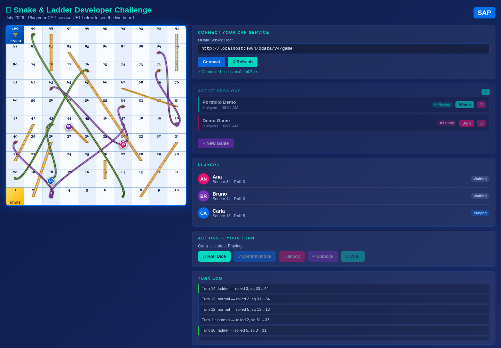

# Snake & Ladder — SAP CAP Game Engine

> **English summary:** A multiplayer Snake & Ladder game engine built with **SAP Cloud Application Programming Model (CAP, Node.js)**. The domain is modelled in **CDS**, exposed as **OData V4** and **MCP** (so an AI agent can play), and game rules are enforced by two declarative **`@flow.status` state machines** plus bound actions and domain events. Built for the SAP Community *CAP Developer Challenge* (July 2026) — all 14 automated verification checks pass.



## Problema

O desafio pedia um "motor" de jogo multiplayer em que **as regras de transição de estado fossem declarativas**: um jogador só pode rolar o dado quando é a vez dele, uma sessão só começa com pelo menos 2 jogadores, uma cobra de duas cabeças bloqueia o próximo turno e o estado anterior precisa ser restaurado depois. Tudo isso exposto como serviço padrão (OData) e consumível por uma interface web e por um agente de IA.

## Solução

- **Modelo de domínio em CDS** (`db/schema.cds`): `GameSessions`, `Players`, `BoardSquares` (100 casas com cobras/escadas, carregadas por CSV) e `TurnLog` (histórico completo de jogadas).
- **Duas máquinas de estado independentes** com `@flow.status`:
  - `GameSessions.SessionStatus`: `Lobby → InProgress → Complete`
  - `Players.TurnStatus`: `Waiting → Playing → Moving → Waiting | Blocked | Finished`
  - As actions usam `@from` / `@to`; o CAP valida o estado de origem (retorna **409** em estado inválido) e grava o estado de destino. `unblockPlayer` usa `@to: $flow.previous` para restaurar o status anterior ao bloqueio.
- **Actions bound** (`startGame`, `rollDice`, `confirmMove`, `blockPlayer`, `unblockPlayer`, `winGame`, `endGame`) implementadas em `srv/game-service.js` com CQL (`SELECT`, `UPDATE`, `INSERT`).
- **Eventos de domínio** (`BoardEvent`, `TurnComplete`, `GameWon`) emitidos com `this.emit` e tratados por subscribers — a rotação de turno é feita no evento, desacoplada da action.
- **View CDS** `BoardState` (projeção com path expressions `session.ID`, `session.name`) para leitura do tabuleiro filtrável por sessão via OData.
- **OData V4 + MCP no mesmo serviço** (`@protocol: ['odata-v4', 'mcp']`): funções unbound `mcpRollDice`, `mcpBoardState` etc. permitem que um assistente de IA (ex.: Claude, via `.mcp.json`) jogue a partida.
- **UI web** (`app/board.html`) servida pelo próprio CAP: lista sessões, cria jogos, mostra os peões sobre o tabuleiro (imagem própria em `app/board.png`) e o turn log, consumindo OData diretamente.
- **Verificação automatizada** (`verify.js`): 14 checagens ponta a ponta das transições de estado.

## Principais técnicas SAP

| Técnica | Onde |
|---|---|
| CDS (entidades, enums, associações, projeções, views) | `db/schema.cds`, `srv/game-service.cds` |
| OData V4 (CRUD, `$filter`, actions bound, functions) | serviço `GameService` |
| `@flow.status` / `@from` / `@to` / `$flow.previous` | actions de `GameSessions` e `Players` |
| Handlers CAP Node.js (`cds.ApplicationService`, `this.on/after`, `req.reject`) | `srv/game-service.js` |
| Eventos de domínio (`event`, `this.emit`) | `BoardEvent`, `TurnComplete`, `GameWon` |
| Dados iniciais via CSV | `db/data/*.csv` |
| CAP MCP (`@cap-js/mcp`) | `@mcp`, funções `mcp*` |
| SQLite para desenvolvimento local | `@cap-js/sqlite` |

## Como rodar

Pré-requisitos: Node.js 22+ (testado com 24.1) e, opcionalmente, `@sap/cds-dk` global.

```bash
npm install
npx cds watch          # ou: npm run watch
```

- Serviço OData: <http://localhost:4004/odata/v4/game> (metadados em `/$metadata`)
- Interface do tabuleiro: <http://localhost:4004/board.html> → **Connect** → **New Game**
- Verificação automática (com o servidor rodando):

```bash
node verify.js http://localhost:4004/odata/v4/game
# All 14 checks passed.
```

Exemplo de fluxo via OData:

```http
POST /odata/v4/game/GameSessions                         {"name":"Minha partida"}
POST /odata/v4/game/Players                              {"name":"Ana","turnOrder":1,"session_ID":"<id>"}
POST /odata/v4/game/GameSessions(<id>)/GameService.startGame
POST /odata/v4/game/Players(<id>)/GameService.rollDice
POST /odata/v4/game/Players(<id>)/GameService.confirmMove
```

### Jogar via IA (MCP)

Com o servidor rodando, o arquivo `.mcp.json` registra o endpoint `http://localhost:4004/mcp/game` para clientes MCP compatíveis.

## Prints

| Partida em andamento |
|---|
|  |

<!-- Espaço para mais prints: lobby, vitória, chamada MCP, $metadata -->

## Estrutura

```
db/        modelo CDS + dados CSV do tabuleiro
srv/       definição do serviço (CDS) e handlers (JS)
app/       UI web do tabuleiro
docs/      entregas semanais do desafio e prints
verify.js  script de verificação ponta a ponta
```

## Contexto

Projeto de estudo desenvolvido para o *CAP Developer Challenge* da SAP Community (julho/2026). Os relatórios das entregas estão em [`docs/`](docs). Não é um produto oficial da SAP.
